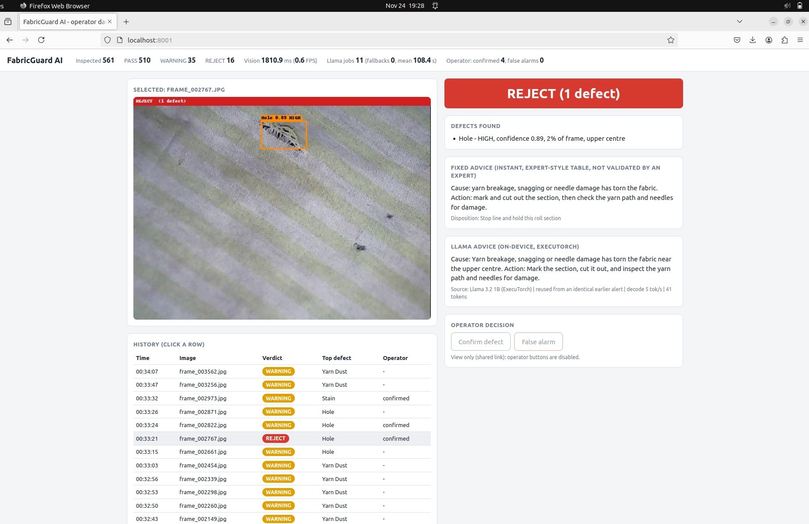
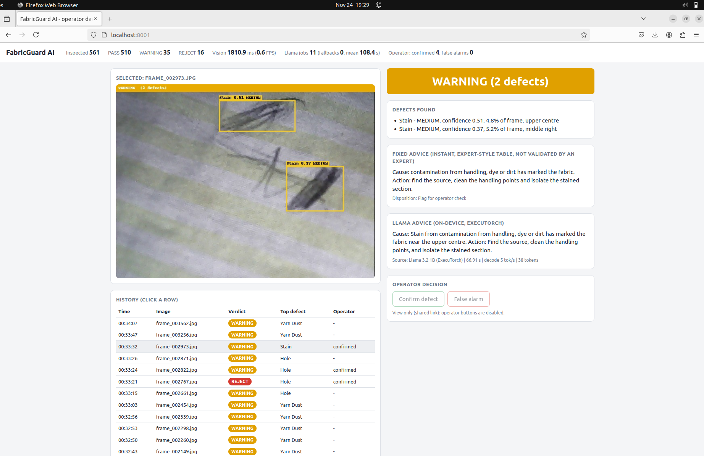
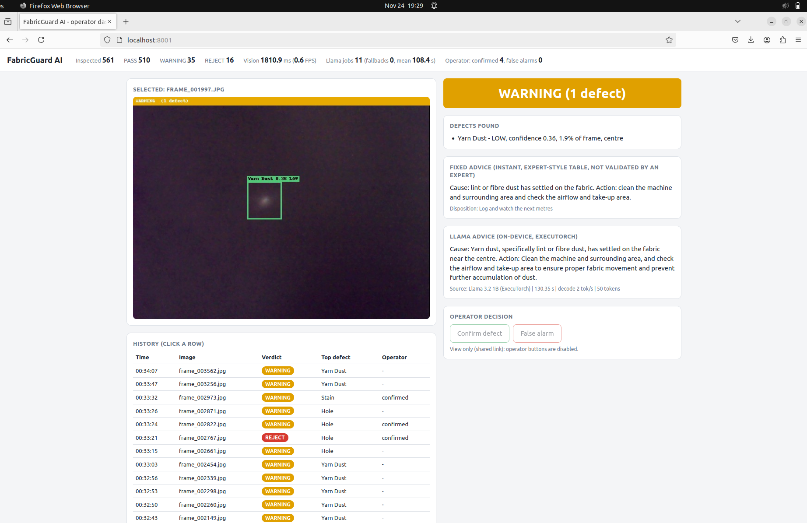

# FabricGuard AI

Edge fabric defect inspection with an on-device Llama advisor. Submission for the Bharat AI-SoC Challenge (Arm), problem statement PS5: on-device industrial quality inspector.

A camera image goes in. The system finds defects, classifies them, rates severity with transparent rules, shows PASS / WARNING / REJECT, gives the operator a recommended action, and logs every inspection locally.

> **Measurement status (read first).** Numbers in the "Speed" laptop table were measured on a laptop (Intel i5-1335U, x86-64, CPU only, no GPU). Numbers in the "On-device (KV260)" section were measured on a Kria KV260 (quad Cortex-A53, CPU only, PetaLinux 2022.2, aarch64). Do not read laptop numbers as edge results. Power was not measured.

## The two pipelines

The vision pipeline and the advisory pipeline are separate, with separate runtimes.

| | Pipeline A: Vision | Pipeline B: Advisory |
|---|---|---|
| Job | Detect and classify defects | Turn a structured finding into a short operator alert |
| Model | YOLOv8n, 12 classes, input 640x480 | Llama 3.2 1B Instruct, 8da4w quantized, 512-token context |
| Runtime | ONNX Runtime, CPU | ExecuTorch (XNNPACK backend), `llama_main` runner |
| Input | Image | Structured record: class, severity, location, confidence, area (never pixels) |
| Output | Boxes, classes, confidences | Two sentences: `Cause:` and `Action:` |
| Code | `pipeline/infer.py`, `models/merged_best.onnx` | `pipeline/severity.py` (prompt builder), `llm/export_llama.yaml` |

Between the two sits a rule-based severity stage (`pipeline/severity.py`).

## Pipeline A: Vision

- **Model:** YOLOv8n trained on Kaggle (T4), imgsz 640, 100 epochs, batch 16, seed 0, patience 30, from COCO-pretrained weights.
- **Export:** rectangular ONNX input `[1, 3, 480, 640]` (height 480, width 640), output `[1, 16, 6300]` (4 box values + 12 classes).
- **Inference:** `pipeline/infer.py` needs only onnxruntime, numpy and Pillow (no PyTorch). It does letterboxing, decoding, NMS, severity rules, JSONL logging and a latency/FPS summary.
- **Classes (12):** DropStitch, Hole, Horizontal LineMark, Knot, Oil Spot, Setup, Slub, Vertical LineMark, Yarn Dust, Needle Mark, Missing Yarn, Stain.

## Pipeline B: Advisory (mandatory Llama on ExecuTorch)

- **Model:** Llama 3.2 1B Instruct exported to ExecuTorch (`.pte`) with 8-bit dynamic activations and 4-bit group-wise weights (group size 32), 8-bit embeddings, KV cache, SDPA, XNNPACK. Export settings: `llm/export_llama.yaml`.
- **Runner:** ExecuTorch 1.6.0, `llama_main` built with `cmake --workflow --preset llm-release` and `make llama-cpu`. For the KV260 it was cross-compiled for aarch64 on the laptop (XNNPACK ARM dotprod, fp16, i8mm and SME kernels switched off).
- **Prompting:** Llama 3 chat format with a strict `Cause:` / `Action:` layout, one worked example, and the facts for the detected class passed in the prompt. A 1B model is not trusted to invent causes: the grounding comes from a fixed advice table in `severity.py`; Llama phrases it and adds the location. Zero-shot prompts gave refusals and made-up causes.
- **Safety net:** the operator sees the fixed advice immediately. Llama text replaces it only when it arrives and passes a shape check (starts with `Cause:`, contains `Action:`, 70 words or fewer). Otherwise the fixed text stays.
- **Async:** Llama runs in a background thread and results are cached by class, severity and location.
- **Note:** `--seq_len` in `llama_main` is prompt plus reply length, and the prompt must not contain `<|begin_of_text|>` (the runner adds BOS itself).

## Severity and verdict rules

Defined in `pipeline/severity.py`. Each detection gets LOW, MEDIUM, HIGH or CRITICAL from its class tier, box area share and confidence. Line marks use span, not area. Hole starts at HIGH. A frame with four or more defects escalates one level.

| Setting | Value | How chosen |
|---|---|---|
| Detection confidence (`MIN_CONF`) | 0.15 | Validation sweep (0.15 / 0.20 / 0.25) |
| REJECT needs confidence at least | 0.50 (default), 0.70 for Hole, Needle Mark, Missing Yarn, Stain | Validation sweep |
| Below the REJECT confidence | never above MEDIUM (becomes WARNING) | Rule |

Verdict per frame: no defects = PASS, LOW or MEDIUM = WARNING, HIGH or CRITICAL = REJECT. Thresholds were fixed on the validation set; the test set was run once afterwards. The advice texts are written from common sense and have not been validated by a textile expert.

## Repository layout

```
data_prep/    prep_bdfd9.py (clean BDFD9), merge_fabrics.py (merge with FabriD), check scripts
training/     training script (see the note under "Reproduce")
evaluation/   result CSVs, confusion matrices, curves, Llama 12-class results, kv260/ (board metrics)
test_results/ organised full test-set results
pipeline/     infer.py, severity.py, eval_image_level.py, test_llama.py, test_llama_all.py,
              dashboard.py (operator web page), live.py (camera / video), collect_metrics.py, make_results_table.py
models/       merged_best.pt, merged_best.onnx (final vision model)
llm/          export_llama.yaml (the .pte itself is not in the repo, 959 MB)
docs/         kv260_live/ (dashboard screenshots and a sample Llama log from the board)
make_board_bundle.sh   builds the folder copied to the KV260
project_status.py      read-only status checker
```

Not in the repo: datasets, the Llama weights and the `.pte` file, the aarch64 `llama_main` binary and the onnxruntime wheels for the board (see "Reproduce" and the licences below).

## Setup and run (laptop)

```
python3 -m venv ~/yolo-venv && source ~/yolo-venv/bin/activate
pip install onnxruntime numpy pillow        # enough for inference
pip install ultralytics                     # only for export, evaluation, training
```

Vision only:

```
python pipeline/infer.py --source <image or folder> --out logs_demo
```

With the Llama advisor (needs the `.pte`, `tokenizer.model` and a `llama_main` binary built for the machine you run on):

```
python pipeline/infer.py --source <image or folder> --out logs_demo --llama \
  --runner <path>/llama_main --pte llm/llama32_1b_8da4w.pte --tokenizer <path>/tokenizer.model
```

Logs go to `<out>/inspections.jsonl` (every inspection, including PASS), `<out>/llama.jsonl` and `<out>/annotated/`. Logs are appended, so use a new `--out` per experiment.

Evaluation:

```
python pipeline/eval_image_level.py --data <fabric_merged>/test --out evaluation/image_level_test.csv --focus 0.15,0.5,0.7
python pipeline/test_llama_all.py        # 12 classes x 3 cases through llama_main
```

## Run on the Kria KV260

The board runs PetaLinux 2022.2 (aarch64, Python 3.9, 3.9 GB RAM). `make_board_bundle.sh` builds one folder (`board_bundle`: pipeline code, `merged_best.onnx`, the `.pte`, tokenizer, aarch64 `llama_main` and sample images) that is copied to `/home/root/board_bundle` with `scp`. Over SSH:

```
export PYTHONPATH=/home/root/pylibs      # onnxruntime 1.16.3 for Python 3.9 aarch64 (the board's built-in onnxruntime crashes)
cd /home/root/board_bundle/pipeline
date -s "YYYY-MM-DD HH:MM:SS"            # the board has no battery clock; log times are wrong after a power cycle

# vision (and Llama) on image files
python3 infer.py --source <sample folder> --out ../logs/demo --llama \
  --runner ../bin/llama_main --pte ../llm/llama32_1b_8da4w.pte --tokenizer ../llm/tokenizer.model

# live USB camera (UVC webcam appears as /dev/video0)
python3 live.py --source 0 --out ../logs/live --width 640 --height 480 --conf 0.35 --cooldown 60 \
  --llama --runner ../bin/llama_main --pte ../llm/llama32_1b_8da4w.pte --tokenizer ../llm/tokenizer.model --max-seconds 600

# operator dashboard, opened from the laptop at http://<board ip>:8001
python3 dashboard.py --logs ../logs/live --port 8001 --host 0.0.0.0
```

Shut the board down with `poweroff` before unplugging it, so the SD card is not corrupted.

## Operator dashboard

`pipeline/dashboard.py` is a local web page for the operator. It uses only the Python standard library and needs no internet, so it runs offline on the laptop or on the board. It reads the log folder written by `infer.py` or `live.py`; it never invents data.

```
# terminal 1: the page
python pipeline/dashboard.py --logs logs_demo --port 8001
# terminal 2: a demo replay (--delay 4 simulates a conveyor; --conf 0.25 is the demo threshold)
python pipeline/infer.py --source <folder> --out logs_demo --conf 0.25 --llama --delay 4
# open http://localhost:8001
```

What the page shows:

- a large PASS / WARNING / REJECT banner with the defect list (class, severity, confidence, area, location)
- the fixed advice at once, and the Llama advice when it is ready, with a source tag (`llama`, or `FALLBACK` to the fixed text), the seconds it took, and whether it came from the cache
- counters: images inspected, PASS / WARNING / REJECT, vision ms and FPS, Llama jobs / fallbacks / mean seconds
- Confirm defect and False alarm buttons; each press is appended to `<logs>/feedback.jsonl` with the time, image, system verdict and the operator's label
- a clickable history of recent WARNING and REJECT frames. Llama advice is attached only to alert events (a new defect class, a worse verdict, or a repeat after the cooldown), so most history rows show "No Llama job for this frame" and the fixed advice applies. While a job runs the panel shows "Generating on-device..."

Sharing: `--read-only` disables the operator buttons and makes the server answer 403 to feedback requests. There is no login, and the default host is 0.0.0.0 (reachable on the local network), so use `--read-only` for any shared view, or `--host 127.0.0.1` to keep it local. Anything shared over the internet is only a view of logged results; inference runs on the device.

Live camera or video: `python pipeline/live.py --source <camera index or video file> --out logs_live --width 640 --height 480 --llama`. It inspects only the newest frame (older frames are dropped if inspection is slower than the camera), logs every frame, and raises an alert (annotated image plus a Llama job) when a defect class first appears, gets worse, or repeats after `--cooldown` seconds. The dashboard shows a live panel while `latest.jpg` is fresh.

Files read from the log folder: `inspections.jsonl`, `llama.jsonl`, `feedback.jsonl`, `annotated/`, `latest.jpg`. `--conf` defaults to 0.15; the 500-image test results below were produced at 0.15, the demo replay at 0.25. If the Llama runner is missing or cannot start (for example an x86 binary on the board), the advice falls back to the fixed text and is tagged `FALLBACK`; the vision pipeline is not affected.

Demo video: [add the link here]

## Reproduce

1. **Data:** download BDFD9 and FabriD (links below), then `python data_prep/prep_bdfd9.py --swap-linemarks` and `python data_prep/merge_fabrics.py`. This gives a 12-class dataset with train 2381 / valid 584 / test 500 images.
2. **Vision model:** trained in a Kaggle notebook with the settings above. [VERIFY: confirm `training/train_yolo.py` matches what was run, or replace this line with the notebook.]
3. **ONNX export:** `yolo export model=models/merged_best.pt format=onnx imgsz=480,640 opset=12` [VERIFY the exact command used].
4. **Llama:** download Llama 3.2 1B Instruct from Meta (accept its licence), then export with `llm/export_llama.yaml` using ExecuTorch 1.6.0 [VERIFY: add the exact export command used].

## Results

### Vision: box level (YOLOv8n merged model, imgsz 640)

| Test set | Images | mAP50 | mAP50-95 |
|---|---|---|---|
| All | 500 | 0.719 | 0.395 |
| BDFD9 only | 142 | 0.878 | 0.489 |
| FabriD only | 358 | 0.346 | 0.162 |

Overall test precision 0.761 and recall 0.706. Weakest classes on test (AP50): Missing Yarn 0.218, Needle Mark 0.247, Stain 0.409, Hole 0.523. Train mAP50 is 0.924 against 0.719 on test, which is an overfitting gap. Ablations: a BDFD9-only model scored 0.925 / 0.455 on the BDFD9 test set (the merged model did not clearly help it); a heavier-augmentation run was not better and was not kept.

### Vision: image level (what the operator sees)

Settings fixed on validation (0.15 / 0.5 / 0.7), test set run once. 412 defect images, 88 clean images.

| Outcome | Validation (490 defect, 94 clean) | Test (412 defect, 88 clean) |
|---|---|---|
| Defect images with nothing flagged ("missed") | 42 (8.6%) | 53 (12.9%) |
| Clean images flagged (WARNING) | 11 (11.7%) | 16 (18.2%) |
| Clean images called REJECT | 0 | 0 |
| Defect images called REJECT / WARNING | 153 / 295 | 112 / 247 |

On test, BDFD9 defect images are missed 2 of 142 (1.4%), FabriD 51 of 270 (18.9%). Misses by class: Missing Yarn 23.7%, Stain 21.3%, Needle Mark 18.8%, Hole 8.7%, all other classes at most 7.1%. With samples this small the uncertainty is large (rough 95% ranges on test: misses 10 to 17%, false alarms 11 to 28%). Sensitivity to the thresholds is in `evaluation/image_level_test.csv`. [VERIFY: state exactly how `eval_image_level.py` defines a miss; image-level checks do not confirm class or box position.]

### Advisory (Llama on ExecuTorch)

| Check | Result |
|---|---|
| 12 classes x 3 cases through `llama_main` (laptop): shape-check pass rate, prompt v3 | 34 of 36 (94%); the two failures were Oil Spot prompts (see `evaluation/llama_12class_v3.csv`) |
| Earlier prompt versions | v1 33 of 36 (92%), v2 31 of 36 (86%); v3 was frozen |
| Reply content | Mostly the fixed advice reworded plus the location, by design |
| On the KV260, live runs | every advisory in the logged runs came from Llama (0 fallbacks in the dashboard counters); replies kept the Cause / Action shape |

### Speed

**Laptop** (x86-64, CPU only; NOT edge results):

| Measurement | Value |
|---|---|
| Vision latency per image (ONNX Runtime) | 24.8 ms mean, 26.5 ms p95, about 40 FPS |
| Llama, 221-token prompt, 41-token reply | prefill 136 tok/s, decode 47 tok/s |
| Llama model load / first token / whole call | 1.4 s / 1.6 s / 3.96 s |
| Vision latency per image while Llama runs at the same time (30-image demo, conf 0.25) | 77.5 ms mean, 250.6 ms p95, about 12.9 FPS |

### On-device (Kria KV260, quad Cortex-A53, CPU only)

Measured with `pipeline/collect_metrics.py` on 30 sample images and 3 Llama runs; raw files are in `evaluation/kv260/` (`metrics_board.json`, `metrics_board.txt`).

| Measurement | Value |
|---|---|
| Vision latency / FPS (ONNX Runtime, 4 threads) | 579.4 ms mean, 577.9 ms median, 588.4 ms p95; about 1.73 FPS (pre-processing 24.9 ms + model 550.3 ms + post-processing 4.0 ms) |
| Verdicts on the 30 sample images | PASS 5 / WARNING 13 / REJECT 12 |
| Llama prefill / decode | 6.6 tok/s / 5.0 tok/s (189-token prompt, about 36 tokens generated) |
| Llama model load, time to first token | about 29 s load (the runner reloads the model on every call); first token 28.6 s after load |
| Frame to Llama advice (one alert) | 65.7 s mean, 66.7 s max when Llama runs alone; a repeated class is served from the cache in 0.0 s |
| Vision latency while Llama runs at the same time | about 1.25 to 1.3 s per image (3-sample run) |
| RAM | 3930 MB total; vision peak 110.5 MB; `llama_main` peak 1159.2 MB |
| `llama_main` built for aarch64 | yes, cross-compiled on the laptop |
| Power | not measured |

**Live USB camera on the KV260** (640x480, Llama on). Each run is one session of `live.py`; PASS / WARNING / REJECT counts are for the inspected frames. There is no ground truth for these runs, so they are speed and behaviour figures, not accuracy figures.

| Run | Frames read | Inspected | PASS / WARNING / REJECT | Alert events | Vision latency mean / p95 | Inspected per second |
|---|---|---|---|---|---|---|
| 30 s, no Llama | 459 | 30 | 8 / 22 / 0 | 7 | 929.8 ms / 1606.2 ms | 1.0 |
| 300 s, Llama on | 4503 | 190 | 150 / 38 / 2 | 23 | 1492.0 ms / 2532.9 ms | 0.6 |
| 600 s, Llama on, cooldown 60 s | 9537 | 318 | 289 / 25 / 4 | 11 | 1795.8 ms / 2579.3 ms | 0.5 |

Most camera frames are dropped because inspection is slower than the camera; the system always inspects the newest frame. While Llama generates, vision slows down because both share the same four cores. In the live runs a fresh Llama advisory took about 65 to 72 s when it ran alone, and about 120 to 140 s when several jobs overlapped with the running camera.

## Limits

- **Small test sets.** BDFD9-only classes have 14 to 33 test boxes, so their scores are noisy.
- **Two sources, uneven strength.** The model is clearly weaker on the FabriD-origin classes (Missing Yarn, Needle Mark, Stain, Hole).
- **Loose boxes.** FabriD polygons were converted to bounding boxes, so some boxes include a lot of background. Box-level mAP50-95 understates detection quality on those classes.
- **False-alarm test is narrow.** All defect-free test images come from FabriD, so the false-alarm rate says little about other fabrics or cameras.
- **Mixed image conditions.** FabriD images were contrast-stretched by their authors; BDFD9 images were not. Both are phone photos, not line-scan camera images.
- **Overfitting.** Train mAP50 0.924 against test 0.719.
- **Hard thresholds.** A hole at 0.69 confidence gives WARNING while 0.71 gives REJECT.
- **Llama's role is small.** The 1B model rewords grounded advice; it does not diagnose. Advice text is not expert-validated.
- **Llama is slow on the board.** A fresh advisory takes about 66 s on the KV260 CPU (the model is reloaded on every call, about 29 s), and longer while the camera is running. Repeats of the same class are cached. The operator sees the fixed advice immediately, so the Llama text is an addition, not a real-time step.
- **Llama slows vision.** Vision and Llama share the same CPU, so latency rises while Llama generates (see the Speed tables).
- **Low inspection rate on the board.** The board inspects about 0.5 to 1 frame per second; the other camera frames are dropped, so a fast-moving fabric could pass between inspected frames.
- **Printed or patterned fabric.** The model was trained on phone photos of plain knitted fabric. In informal tests with USB cameras, striped or printed fabric and shadows were sometimes read as defects (mostly Hole and Stain WARNINGs). This was not measured; raising `--conf` reduces it but can also hide real defects.
- **Cameras not validated.** The live mode was tried with two 640x480 USB webcams (a Sonix UVC camera and a Logitech C170); accuracy on camera video has not been measured.
- **No power measurement.** Power and energy per inspection on the KV260 were not measured.
- **Board clock.** The board has no battery clock; set the date after every power-up or the log times are wrong.
- **Dashboard has no login.** Use `--read-only` and a trusted network when sharing it.
- **Edge numbers.** See the measurement status at the top of this README.

## Datasets and credits

- **BDFD9** (v3): Nath, P. C., Zahra, F., Islam, A., Shah, M. M. A., Miah, M. S. U., and Rahman, M. M. (2026). *BDFD9: An annotated image dataset of nine fabric defect types collected in Bangladeshi textile and garment factories* (Version 3). Mendeley Data. https://doi.org/10.17632/z49cc7zvfc.3. Licence CC BY 4.0.
- **FabriD** (v3): Ahmed, S., Ahmed, I., Mahzabin, N., and Islam, T. (2026). *FabriD: Fabric Defect Detection Dataset* (Version 3). Mendeley Data. https://doi.org/10.17632/vncdwps24r.3. Licence CC BY 4.0. Distributed as a Roboflow export.
- **Changes made:** BDFD9 images rotated to landscape and letterboxed to 640x480 with boxes transformed; FabriD polygons converted to boxes, 30 training images removed to avoid leakage, then both merged into 12 classes.

## Licences and third-party components

- **Code in this repository:** GNU AGPL-3.0 (see `LICENSE`). This matches the licence of YOLOv8, which the training and export code uses.
- **Llama 3.2** is used under the Llama 3.2 Community License. The weights and the exported `.pte` are not included.
- **YOLOv8 (Ultralytics)** is licensed under AGPL-3.0, which is why this repository is released under the same licence.
- **ONNX Runtime, ExecuTorch, XNNPACK, NumPy and Pillow** are used under their own open-source licences.

## On-device demo (Kria KV260)

Live run: 561 frames inspected, 510 PASS, 35 WARNING, 16 REJECT. Llama 3.2 1B (ExecuTorch) generated advice for 11 alerts on the board.

| Hole (REJECT) | Stain (WARNING) | Yarn Dust (WARNING) |
|---|---|---|
|  |  |  |

Sample Llama log: [`docs/kv260_live/live13_llama.jsonl`](docs/kv260_live/live13_llama.jsonl)

### Next steps (second evaluation)

The current board results run the vision model as ONNX (`merged_best.onnx`) on the KV260's CPU. In the second evaluation we plan to run it on the board's DPU (Deep Learning Processing Unit) instead, using the Vitis AI toolchain (quantize, compile to `.xmodel`, run with VART), to improve vision latency and FPS. We expect a gain because the DPU is built for this workload, but we have not measured it yet. The same metrics script will be re-run so the two runs can be compared directly. Power will also be measured, which this evaluation did not do.

### Measured performance (Kria KV260)

Source: `evaluation/kv260/metrics_board.txt` (isolated benchmark) and the live dashboard session shown above.

| Measurement | Benchmark (30 images, 3 Llama runs) | Live session |
|---|---|---|
| Vision latency | 579 ms mean (1.73 FPS) | 1810 ms (0.6 FPS) |
| Llama advice per alert | 65.7 s mean | 108.4 s mean |

- The live session is slower than the benchmark, probably because vision, the dashboard and Llama run at the same time on one board.
- Memory: Llama 3.2 1B peaks at about 1.16 GB and the vision process at about 110 MB, on a board with 3.9 GB.
- Llama reloads the model on every call (about 29 s of the roughly 66 s response time).
- The fixed advice appears on screen after the vision step (about 0.6 s in the benchmark), well before the Llama advice.
- Power was not measured.
